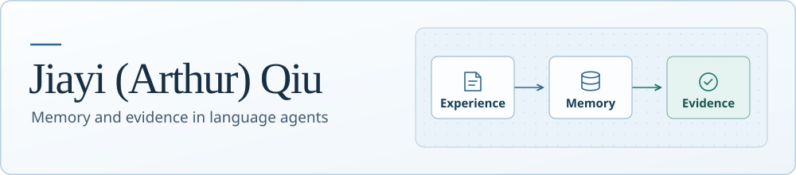

<h1>
  <a href="https://arthurqqqq.github.io/">
    <picture>
      <source media="(prefers-color-scheme: dark)" srcset="https://raw.githubusercontent.com/ArthurQQQQ/ArthurQQQQ/main/research-header-dark.svg">
      <source media="(prefers-color-scheme: light)" srcset="https://raw.githubusercontent.com/ArthurQQQQ/ArthurQQQQ/main/research-header.svg">
      
    </picture>
  </a>
</h1>

**Honors Carolina undergraduate · UNC–Chapel Hill**

I study how agents learn continually from experience and stay reliable over long horizons.

I work with [Shashank Srivastava](https://www.ssriva.com/) ([Lab](https://l3.cs.unc.edu/ "Learning from Language Lab (L³)")) and [Snigdha Chaturvedi](https://cs.unc.edu/person/snigdha-chaturvedi/) ([Lab](https://nlp.cs.unc.edu/#lab-Chaturvedi-Lab "Chaturvedi Lab")). I’m writing my honors thesis in economics with [Peter R. Hansen](https://econ.unc.edu/people/hansen-peter/).

**[Personal website](https://arthurqqqq.github.io/)** · **[Google Scholar](https://scholar.google.com/citations?user=WC9dYREAAAAJ&hl=en)** · [Interactive figures](https://arthurqqqq.github.io/#research) · [Repositories](https://github.com/ArthurQQQQ?tab=repositories) · [Email](mailto:arthurq@ad.unc.edu)

## Research code

- **[MULTIPASS](https://github.com/ArthurQQQQ/multipass-multihop-retrieval-ICMLW)** · *[ICML 2026 · Failure Modes in Agentic AI Workshop](https://icml.cc/virtual/2026/77991)*  
  A bounded second retrieval pass follows a bridge clue to recover missing evidence.
- **[Atom-Keyed Chunk Retrieval](https://github.com/ArthurQQQQ/atom-keyed-chunk-retrieval-qa-ICMLW)** · *[ICML 2026 · Graph Foundation Models Workshop](https://icml.cc/virtual/2026/67543)*  
  Ranks atomic propositions and retrieves their original passages for long-document QA.
- **[SIFT reproduction](https://github.com/ArthurQQQQ/SIFT-LLM-feature-reweighting-tabular-ICDMW)** · *[ICDM 2025 · VISTA Workshop (original paper)](https://doi.org/10.1109/ICDMW69685.2025.00298)*  
  Reproduces the feature-weighting experiment for low-resource tabular learning.

## Research workflows

- **[Skill Editor](https://github.com/ArthurQQQQ/skill-engine)** · *GitHub*  
  A local workspace for finding, comparing, and maintaining agent skills.
- **[Paper Structure Review](https://github.com/ArthurQQQQ/advisor-ready-paper-structure)** · *GitHub*  
  Helps scope a research idea or review the argument and structure of a draft offline.
- **[Paper → Presentation](https://github.com/ArthurQQQQ/paper-presentation-skill)** · *GitHub*  
  Builds a talk around a paper's mechanism, worked example, and experimental evidence.

## Personal website

- **[Research homepage](https://arthurqqqq.github.io/)** · *GitHub Pages*  
  Papers, interactive figures, and project links. [Website source](https://github.com/ArthurQQQQ/arthurqqqq.github.io)

## Other builds

- **[YueLao](https://github.com/ArthurQQQQ/yuelao-chatgpt-plugin)** · *GitHub*  
  A Chinese-language conversation prototype with a case library linked to source clips.

Research interests and teaching

- Continual learning and long-term memory for agents.
- Retrieval and evidence use in long-context reasoning.
- Signals for answer-relevant evidence in frozen models.

I study Computer Science and Economics with a minor in Mathematics. I’ve spent six semesters as an undergraduate learning assistant in econometrics, time series, and calculus.

